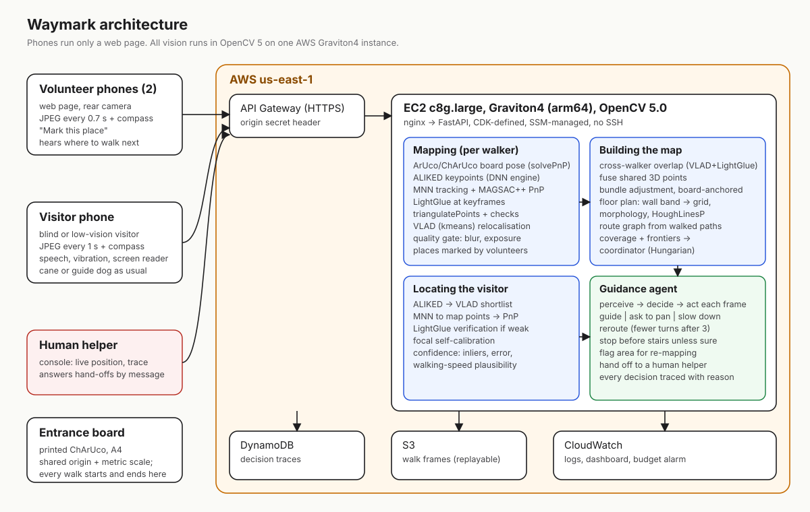

# Waymark

**Two volunteers walk a building with their phones for 15 minutes. After that, a blind visitor can be guided through it by voice.**

GPS stops at the front door. Indoor guidance for blind and low-vision people exists, but it needs beacons installed in the ceiling or a venue mapped by a large company first, so almost no buildings have it. Waymark needs a printed sheet of paper, two phones with a web browser, and OpenCV 5 running on one AWS Graviton instance.


**Try it in 30 seconds** (no install, no account): [open the sample building](https://5hfibd6grf.execute-api.us-east-1.amazonaws.com/helper.html) to see a merged two-walker map, a route and every decision the guide made · [guidance app](https://5hfibd6grf.execute-api.us-east-1.amazonaws.com/go.html) on a phone · [mapping app](https://5hfibd6grf.execute-api.us-east-1.amazonaws.com/map.html) · [landing page](https://5hfibd6grf.execute-api.us-east-1.amazonaws.com/) · [technical report](docs/REPORT.md) · [judges' guide](docs/JUDGES.md)

## Results

All numbers come from scripts in `eval/` and can be re-run with one command (see [Reproduce](#reproduce)).

| What was measured | Result | Data |
|---|---|---|
| Two walkers merged into one map: keyframe position error | **1.2 cm median, 4.2 cm worst** | Microsoft 7-Scenes, two sequences as two walkers, ground truth from the dataset |
| One walk, tracked live with no board in view | 13 to 23 cm median | same |
| Same walk after board-anchored bundle adjustment | 2.0 to 7.5 cm median | same |
| Bundle adjustment on synthetic data with 15% gross outliers | 4.6 mm pose error, 0.4 s | `eval` synthetic test |
| Relocalising a visitor's frame (7-Scenes protocol) | RELOC_RESULT | HLoc publishes 1.0 cm on this scene ([A-SCoRe table](https://arxiv.org/pdf/2503.13982)) |
| Per-frame cost on Graviton4 (c8g.large) | SPEED_RESULT | `eval/speed.py` |
| Real building, blind and low-vision participants | FIELD_RESULT | see the report |

## How it works

1. **One sheet of paper fixes the building's frame.** A ChArUco board printed on A4 is taped by the entrance. Every walk starts and ends there, so every volunteer's map shares one origin and one metric scale before any matching happens.
2. **Each volunteer is tracked from their phone's photos.** ALIKED keypoints run on OpenCV 5's new DNN engine. Frame-to-frame tracking uses fast mutual-nearest-neighbour matching and MAGSAC++ PnP; LightGlue, which is far more precise but slower, is used only where a wrong match is expensive (new keyframes, loop closures, merging). New keyframes triangulate new 3D points.
3. **An agent sends the volunteers to different places.** It casts rays from every keyframe to find floor that has been seen but not walked, groups it into regions and assigns them with the Hungarian algorithm, then tells each person where to go next.
4. **The walks are merged.** Places seen by both volunteers are found with VLAD retrieval and verified with LightGlue and PnP. Their 3D points are fused, and a bundle adjustment anchored to the board pulls both walks into agreement.
5. **A floor plan and a route graph come out.** Points between knee and head height become walls (occupancy grid, morphology, HoughLinesP). Routes are built only from paths a sighted volunteer actually walked.
6. **The visitor's phone finds itself every second.** VLAD shortlist, matching to map points, PnP, and LightGlue verification when the evidence is weak. Visitors never calibrate their phone: the focal length is estimated from the first few frames.
7. **A guidance agent decides what to say.** Each frame gives it image quality, a position and a confidence. It gives one instruction at a time, asks the visitor to pan when it can't see enough, slows them down when unsure, re-routes with fewer turns after repeated mistakes, stops before stairs unless the fix is strong, flags corridors that no longer match the map, and hands over to a human helper instead of guessing. Every decision is stored with what it saw and why.



## Safety

Waymark adds directions. It does not detect people, open doors, wet floors or anything that moves, so a cane or guide dog still does that job, and the app says so before every visit. Guidance pauses before stairs unless the position is certain. After six frames without a confident position, the agent stops giving directions and calls the human helper. Faces in volunteer photos are not used for anything, and only walk frames are archived (30-day expiry).

## Reproduce

```bash
git clone https://github.com/kinnuworks/waymark && cd waymark
scripts/fetch_models.sh                      # ALIKED + LightGlue ONNX, SHA-256 checked
uv sync --project server
uv run --project server uvicorn waymark.api:app --app-dir server --port 8000
```

```bash
# Benchmarks (downloads Microsoft 7-Scenes "heads", about 1 GB)
SEVENSCENES=eval/data/7scenes bash scripts/remote_eval.sh all
```

```bash
# Deploy your own copy on AWS (CDK: Graviton instance, API Gateway, S3, DynamoDB, CloudWatch)
scripts/deploy.sh && scripts/update.sh
```

Pinned dependencies are in `server/uv.lock`. The HTTP API is documented in [docs/API.md](docs/API.md).

## Repository

| Path | What is there |
|---|---|
| `server/waymark/vision` | features (ALIKED, LightGlue, MNN), board, camera, geometry, VLAD retrieval |
| `server/waymark/mapping` | walker tracker, bundle adjustment, merge, floor plan, routes, coverage |
| `server/waymark/localize` | visitor relocalisation and confidence |
| `server/waymark/agent` | guidance agent |
| `web/` | landing page, mapping app, guidance app, helper console, field-test page |
| `eval/` | 7-Scenes benchmarks, speed benchmark, sample building |
| `infra/`, `scripts/` | AWS CDK stack and deploy, update and benchmark scripts |

Licence: MIT. Model weights keep their own licences: ALIKED (BSD-3-Clause), LightGlue (Apache-2.0).
